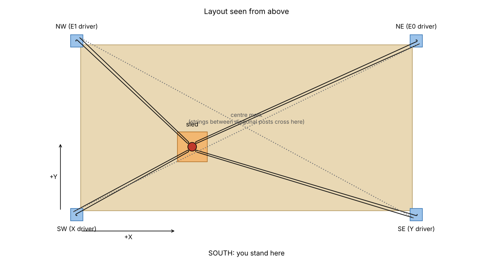
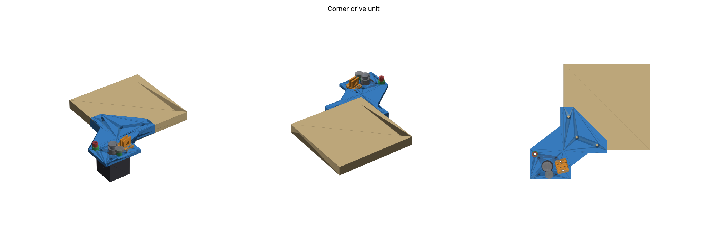
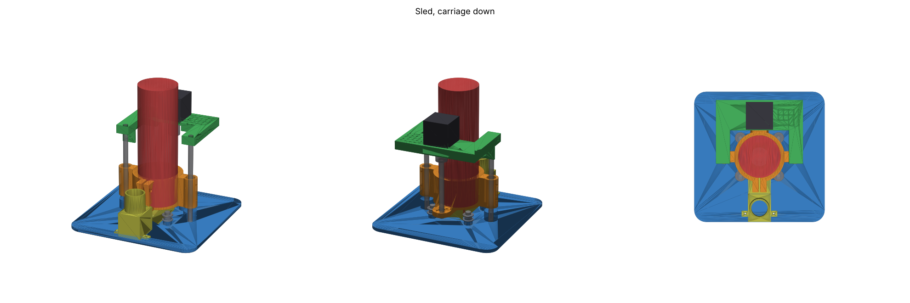
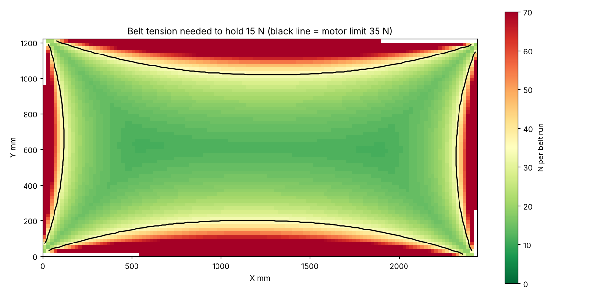
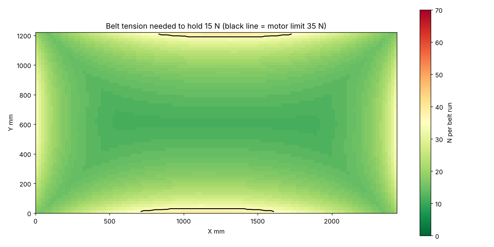
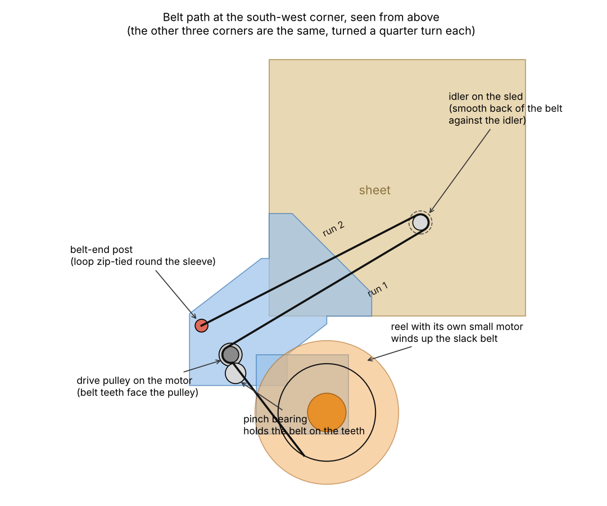

# Build instructions

Read this once all the way through before starting. Allow a week of evenings for printing, a day for mechanical assembly, a day for wiring and a day for setup.

**Tools you need:** hex keys (1.5 to 4mm), small screwdrivers, an 8mm spanner, hacksaw, round file, drill with 3mm and 8mm bits, tape measure, and the few wiring tools listed in [WIRING.md](WIRING.md).

**General tips**
- Lay out the parts for each step before starting it, and do one corner unit completely before the other three.
- Screws going into plastic: stop as soon as they feel snug. Overtightening strips the hole.
- A nyloc nut is the kind with a plastic ring. It stays where you leave it, so "tighten until it still spins" means exactly that.
- If a printed hole is tight, twist a drill bit through it by hand.



## How it works

A stepper motor sits at each corner of the table. Each drives a belt that runs out to the sled, round an idler, and back to a post at the same corner. Slack belt is wound onto a reel at each corner by a small motor, so the whole length stores on the corner unit when you pack away. The sled carries the router and the Z axis, and nothing else.

Naming used throughout: stand at one long edge. That edge is **south**. The corner on your left is **south-west (SW)**. X runs left to right, Y runs away from you.

## Safety

- The router is a mains tool spinning at 30,000 rpm. Wear eye and ear protection. Keep hands off the table while it runs.
- Plug the router and the power supply into one switched extension lead within arm's reach. That switch is your emergency stop.
- Never leave the machine cutting unattended.
- A diode laser on an open table can blind. Wear glasses rated for its wavelength, keep others out of the room, and never run it over a reflective surface.
- The donor printer's bed is mains powered. Unplug it and wait 10 minutes before opening it.

## 1. Print everything first

Do this before you take the printer apart. Files and settings are in PARTS.md. Print one spare of each small spacer and sleeve.

Test fits as you go:
- A 65mm router body should slide into `z_carriage` with the clamp open and grip when closed.
- `pen_slider` should drop freely through `pen_caddy_body`.
- `f_sleeve` should spin on an M5 bolt.
- An 8mm rod should push into the sockets in `sled_base` and `z_bridge` by hand, snug.

If a fit is wrong, reprint now. The numbers to change are at the bottom of `cad/geometry.py`; run `python3 cad/build.py` to regenerate.

## 2. Strip the printer

Keep everything in PARTS.md under "From the Artillery Sidewinder X1". Label the five motors. Cut one lead screw to 115mm and file the cut end smooth.

## 3. Build four corner units



All four are identical.

1. From underneath the bracket, push an **M5 x 30 hex bolt** up through the hole that sits on its own near the outer edge (the belt-end post) and an **M5 x 25 hex bolt** up through the hole right beside the big motor hole (the pinch post). The heads sit in the hex pockets.
2. Hold a motor against the underside, shaft up through the big hole, plug facing away from the sheet. Fix with four **M3 x 8** screws from the top. The motor now traps both bolt heads.
3. Belt-end post: add `f_spacer`, then `f_sleeve`, a washer and a nyloc nut. Tighten until the sleeve still turns freely. About 6mm of thread should stick out above the nut.
4. Pinch post: add `k_spacer` (lip up), a **625 bearing**, then a nyloc nut with no washer. The bearing must spin.
5. Fit a **20-tooth pulley** to the motor shaft, grub-screw end down, about 0.5mm clear of the bracket. Its teeth should be level with the bearing. Tighten one grub screw onto the flat of the shaft.
6. Check the gap: a scrap of belt, teeth against the pulley, should slide between pulley and bearing with light drag. If it jams, ease the bolt hole with a round file. If the belt can lift off the teeth, the gap is too big and that bracket needs reprinting.
7. Reel motor: push an **N20 motor** up into the pocket under the bracket, shaft through the small hole. Hold it there with `n20_cup` and two **M3 x 12** screws, wires out through the slot.
8. Reel: screw `reel_flange` to the hub of `reel_body` with three **M3 x 12** screws, then push the reel onto the motor's D-shaped shaft. It should turn level, clear of the bracket.
9. The panel that hangs down, with the grid of holes, takes a network breakout board. Fitting and wiring it is covered in WIRING.md.

## 4. Build the sled



1. Push four **M5 x 30 countersunk bolts** up through the sled base. The heads must sit below the surface. On each, fit a smooth idler and a nyloc nut. The idlers must spin.
2. Press two **LM8UU** bearings into each side of `z_carriage` from the top. Nip each with an **M3 x 12** screw in the side hole. Do not crush them.
3. Bolt the brass lead-screw nut to the tab on the carriage, flange on top, with four **M3 x 10** screws and nuts.
4. Push the two **8mm rods** into the base sockets to the bottom. Fix each with an M3 x 12 screw in the side hole.
5. Slide the carriage down onto the rods. It should move freely by hand. The clamp slot faces the front, the nut tab faces the back.
6. Fix the Z motor on top of `z_bridge`, shaft pointing down, with four **M3 x 8** screws from underneath. Fit the coupler and the cut lead screw.
7. Screw the microswitch to the tab under the bridge with two M2 screws, on the face that points to the front, lever down.
8. Lower the bridge onto the rod tops while turning the lead screw into the nut by hand. Fix with M3 x 12 screws in the side holes.
9. Screw `dust_shoe` to the base with two M3 x 12 screws. Take it off for pen and laser work.
10. Fit the router: slide it into the ring, tighten the two **M5 x 30** clamp bolts. Nuts sit in the hex pockets.

## 5. Electronics

Follow **[WIRING.md](WIRING.md)**. It is written for a first-timer. The leads are ordinary network cables and every wire goes under a screw terminal, so there is almost no soldering.

Summary of where each lead goes:

| Board socket | Lead |
|---|---|
| X | SW corner |
| Y | SE corner |
| E0 | NE corner |
| E1 | NW corner |
| Z, plus the Z- endstop | Sled |
| HE0 | The four reel motors |

**Always switch off before plugging or unplugging a lead.** Pulling a stepper lead under power can destroy its driver.

Put the tray at the middle of the south edge. Hang the sled lead, router flex and vacuum hose from above (a hook in the ceiling and a bungee works), so they never drag on the sled.

## 6. Firmware

You do not need to compile anything. On GitHub, open the repo's **Actions** tab, pick the latest green **Belt CNC firmware** run, and download the **belt-cnc-software** artifact. It contains the built firmware, `flash.sh` / `flash.bat` to put it on the board, the settings file and the tools. Then:

```
python3 tools/beltcnc.py test                          # 22 self-checks, no machine needed
./flash.sh /dev/tty.usbserial-XXXX                     # Windows: flash.bat COM5
python3 tools/beltcnc.py upload --port PORT belt-cnc.yaml
```

`firmware/INSTALL.md` covers building it yourself instead.

## 7. Set up the table

There are two ways to mount the corner units. Pick by how much of the sheet you need.

**Setup A: units on the sheet's own corners.** Quickest and smallest. The router can reach about 70% of the sheet: it cannot hold position within about 210mm of the middle of the long edges or 130mm of the middle of the short edges. Corners are fine.



- Lay the sheet on 50mm foam board on the floor or on trestles. The motors hang just outside the corners.
- Leave `belt_dz` at 0.

**Setup B: end boards.** Reaches about 99% of a full sheet, at the cost of a footprint of 2740 x 1620mm.



- Cut two boards about 300 x 1620mm from any sheet material. Raise them on lengths of 2x2 timber so the motors clear the floor.
- Lay one under each short end of the sheet, sticking out 150mm past the short edge and 200mm past both long edges. Support the middle of the sheet at the same height.
- The corner units go on the outer corners of the end boards.
- Set `belt_dz` in the config to the thickness of your sheet, because the units now sit that much lower than the sled.
- Lay offcuts of the same thickness as the sheet on the end boards, butted up to it, so the sled has something to ride on near the short edges.

In either setup the sled needs support under at least half its base. Along an unsupported edge, plan on a 60mm border.

**Small workpieces.** Use any flat board as the base, units on its corners as in setup A, and tape or screw the workpiece in the middle. Pack scrap of the same thickness around it so the sled stays level. Set `belt_dz` to the workpiece thickness, or lift each unit on `riser_shim` plates to match.

To check any other size before committing: `python3 tools/simulate.py --width 1200 --height 800`.

**Fitting a unit:** push the two fence walls hard against both edges of the corner. For a board you will reuse, mark the three holes, drill 8mm, and hammer **M6 T-nuts** in from underneath. Screw an M6 x 40 bolt up through each T-nut from below so it sticks up as a stud. Drop the unit over the studs and hold it with penny washers and wing nuts, so it comes off in seconds. For a one-off sheet, three wood screws with washers do the job.

**Measuring:**

1. Put a `measuring_cap` on two belt-end posts. Hook the tape on the flat face of one cap and read at the flat face of the other.
2. Measure S, E, N, W and the diagonal D (north-west post to south-east post), to the millimetre.
3. Run:
   ```
   python3 tools/table_config.py S E N W D --write firmware/belt-cnc.yaml
   ```
   and upload the updated config. The table does not need to be square. The tool reports how far out it is.
4. Mark the centre: stretch a string between diagonally opposite posts, then the other pair. Mark where they cross.

## 8. Fit the belts



1. Cut four belts. For a full sheet each is 5.6m. `table_config.py` prints the length for your table.
2. At one end of each, fold 40mm back on itself, teeth meshed, and fix with two small zip ties to make a loop that slips over an `f_sleeve`. Fold 10mm over at the other end with one zip tie, and slide that end down into the slot in the reel hub.
3. Thread each corner as in the picture: loop on the post, out round the sled idler with the **smooth side against the idler**, back to the pulley on the **post side**, round the outside of the pulley with the **teeth against it**, between pulley and pinch bearing, and on to the reel. Wind the spare belt onto the reel by hand for now.

Every belt must be threaded the same way round. If one is mirrored, that corner's length will be wrong and the machine will not position properly.

## 9. First power-up

Connect a laptop by USB and run:
```
pip install pyserial
python3 tools/belt_setup.py --port /dev/ttyUSB0 --config firmware/belt-cnc.yaml
```
The reel motors start as soon as the script connects. Each should pull gently in the winding-up direction.

1. **Directions.** With the belts off the sled idlers, type `dirtest`. Each corner should pay belt out, then take it back. Fix any that go the wrong way (the script says how) and repeat.
2. **Centre.** Quit the script. Hook the belts over the sled idlers. Put a V-bit or a pencil in the sled and stand it on the centre mark, sled edges parallel to the table edges. Switch the controller off and on, then start the script again. The controller assumes it wakes up at the centre.
3. **Snug.** Take in belt one corner at a time, for example `sw 5`, until each belt is straight with no sag. Then `all 0.5` once or twice. The belts should feel like a loosely strung guitar, not a tight one. If the point has drifted off the mark, take in a little on the side it needs to move towards.
4. **Test.** Type `square 300 800`. The sled traces a square and should come back onto the mark, with no belt going slack on the way. Then try `square 800 1500`.
5. **Z.** Type `homez`. The router rises until the switch clicks.

Do steps 2 to 5 each time you set the machine up. They take a few minutes.

## Packing away and setting up again

**Packing away**
1. Park the sled on the centre mark and raise Z.
2. Type `pack`. Unhook the belts when asked. Each corner winds its belt onto its reel, leaving about 150mm out.
3. Type `off`, switch off at the wall, unplug the five leads, undo the wing nuts and lift the corner units off.

**Setting up again**
1. Bolt the corner units back on the same corners (label them), plug in, stand the sled on the centre mark and switch on.
2. Start the script and type `stowed`, then `unpack`. The first tells the controller the belts are wound in, without moving anything. The second pays each belt out to the length it needs.
3. Hook each belt round its sled idler and onto its post, then snug and test as above.

If the units go back on the same holes in the same board, the table measurements still hold.

## 10. Set Z zero and draw something

1. Fit the pen caddy with a pen. Jog Z down about 15mm from the top.
2. Loosen the thumb screws, let the pen touch the surface, tighten, then set Z zero in your sender.
3. Make G-code with any CAM tool that outputs plain G-code (Fusion, Estlcam, Kiri:Moto, Inkscape) and send it with FluidNC's built-in web page or Universal Gcode Sender. Jog to where the job should start and zero X and Y there.

## 11. Calibrate

```
python3 tools/make_test_pattern.py --table 2440 1220 --inset 300 > dots.gcode
```
Run it with the pen. Measure the six distances between the dots and give them to `tools/calibrate.py` (run it with `--help` for the order). It tells you how much to change `steps_per_mm` and the post measurements. Belt stretch is the main error, so expect to do this once and gain a lot.

## 12. First cuts

Start gentle and work up:

| Setting | Start with |
|---|---|
| Bit | 1/8" single-flute upcut |
| Depth per pass | 1.5mm |
| Feed | 400 mm/min |
| Plunge | Ramp in, never straight down |
| Router speed | Lowest or second lowest |
| Tabs | Yes, so cut parts stay put |

To set Z zero with the router: jog Z about 15mm down from the top, loosen the clamp, lower the router until the bit touches the wood, tighten, set Z zero.

If the cut wanders or a motor clicks, the load is too high: halve the depth.

## 13. Pen and laser caddies

Both clamp in the carriage ring in place of the router, seating on their lip.

- **Pen:** the slider floats, so the pen follows the surface under its own weight. Two thumb screws press the pen into a V, which takes anything from a pencil to a 20mm paint marker. For more pressure, loop a rubber band from the pegs over the top of the slider.
- **Laser:** the square pocket takes a 33 to 40mm module. Pack smaller ones with `laser_shim`. Slide the module up or down to set focus, then tighten the thumb screws. Wire its PWM input to pin 2 of the EXP1 header and its power to the 24V supply (or 12V via the module's own adapter). The beam goes down through the hole in the sled.

## If something is wrong

| Symptom | Likely cause |
|---|---|
| A belt goes slack during the square test | Table measurements are off, or a belt is threaded the wrong way round |
| Sled does not come back to the mark | A motor skipped: lower the feed, check that driver's current |
| Squares come out as diamonds | Diagonal D was measured wrongly |
| Everything is slightly too big or small | Belt scale: run the calibration |
| Belt jumps teeth at a corner | Pinch gap too wide |
| A reel does not wind, or unwinds | Swap that reel motor's two wires |
| Reels too weak to take up slack, or belt loops form | Fit a lower resistor (82 ohm). If the motors get hot, fit a higher one |
| Router sinks when powered off | 8mm-lead screw: park it at the top, or fit the 2mm-lead screw |
| Sled lifts when plunging | Plunge slower, use an upcut bit, ramp in |

## What has and has not been checked

This design has not been built. Before you spend money, know what stands behind it:

**Checked on a computer**
- Every printed part is a single solid, fits a 300mm bed, and needs no supports.
- No part collides with another part, a motor, a bearing or the router, with the carriage at both ends of its travel.
- The firmware's belt maths matches an independent Python model to within 0.002mm over 400 test positions, on square and out-of-square tables.
- The firmware module passes a syntax check against the current FluidNC source.
- The reach maps come from a force calculation, assuming each motor can hold 35N of belt tension and the sled needs 15N to push it.

**Not checked**
- A full firmware build and a run on a board. I could not download the build tools here.
- Any fit that depends on your printer or your particular pulleys and idlers. The pinch gap in step 3.6 is the tightest.
- The reels. Their motors are run at low power so the stepper can pull belt off against them. The resistor value is my estimate and may need changing. This is the part I trust least.
- Accuracy while cutting. Expect about 1mm across a sheet after calibration, better over short distances.
- The details of the Sidewinder X1. I worked from memory of that model.
