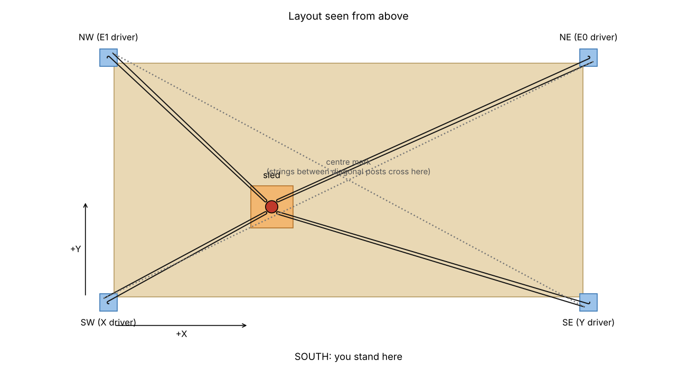

# Belt CNC

A full-sheet CNC router that packs away. Four stepper motors at the corners of the table pull a small sled around on belts. The sled carries a trim router, a pen or a laser.

**This design has not been built yet.** See the last section of BUILD.md for what has been checked and what has not.

## Start here

| File | What it is |
|---|---|
| [belt-cnc-build-guide.pdf](belt-cnc-build-guide.pdf) | The printable step-by-step guide, with life-size drawings of every fastener. Print at 100%. |
| [PARTS.md](PARTS.md) | What to salvage from the Artillery X1, what to buy, what to print |
| [BUILD.md](BUILD.md) | Step-by-step construction and setup |
| [WIRING.md](WIRING.md) | Beginner's guide to the wiring, with diagrams. Network leads and screw terminals, almost no soldering |
| [firmware/INSTALL.md](firmware/INSTALL.md) | Putting the software on the controller |
| `stl/` | Printable parts, ready to slice |
| `renders/` | Pictures of every part and the assemblies |

## Design in brief

- **Drive:** each corner has a motor with a toothed pulley. The belt goes pulley, idler on the sled, back to a post at the corner. That doubling halves the load on the motor and doubles the stiffness. A small motor at each corner winds the slack onto a reel, so the belts store on the corner units.
- **Sled:** 220mm square, with a clamp ring for a 65mm router on a 38mm Z axis.
- **Tools:** router, floating pen holder (6 to 20mm pens), laser holder (33 to 40mm modules). All clamp in the same ring.
- **Controller:** MKS TinyBee running FluidNC, plus a module in `firmware/` that turns X and Y into four belt lengths.
- **Setup:** five tape measurements describe the table. A script turns them into settings.
- **Reach:** about 70% of a sheet with the drives on the sheet's own corners, about 99% with the drives on boards set outside the corners.

## Software

| Script | Use |
|---|---|
| `tools/table_config.py` | Five measurements in, controller settings out |
| `tools/belt_setup.py` | Check motor directions, snug the belts, run a test square, wind the belts in for storage |
| `tools/simulate.py` | Map where on a given table the machine can hold the router |
| `tools/make_test_pattern.py`, `tools/calibrate.py` | Mark test dots, then correct scale from measurements of them |
| `tools/beltkin.py` | The belt geometry model the others share |
| `tools/make_pdf.py` | Rebuild the PDF guide (needs `reportlab` and `pillow`) |
| `cad/build.py` | Regenerate every STL from `cad/parts.py` and `cad/geometry.py` |

The scripts need Python 3 with `numpy` (and `matplotlib`, `manifold3d` for the CAD and diagrams, `pyserial` for USB).

For drawing and toolpaths use any program that writes plain G-code. Send it with FluidNC's built-in web page or Universal Gcode Sender.
