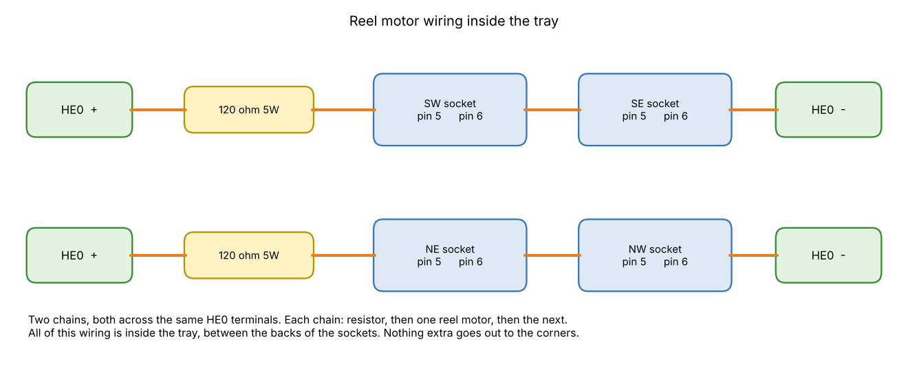

# Wiring guide for beginners

This covers everything electrical: tools, soldering, making the leads, and testing before you switch on. No experience assumed. Take it one lead at a time and test each one before moving on.

**The whole job in one paragraph.** One board in a tray drives five motors. Each corner of the table has a stepper motor and a small reel motor, joined to the tray by one 6-core lead with a screw-locking plug on each end. The sled has the Z motor and a switch on a fifth lead. The power supply from the old printer feeds the board. The router has its own mains plug and is not wired to the board at all.

## Stay safe

- **Everything you wire is 24V or less.** It cannot shock you. Never open the power supply or work on anything mains.
- **Unplug from the wall before touching any wiring.** Not just switched off: unplugged.
- **Never plug or unplug a motor lead with the power on.** It can destroy the driver for that motor. This is the most common way people break these boards.
- A soldering iron is about 350°C. Keep it in its stand, and wear glasses, because solder can spit.
- Work near an open window. Solder fumes are unpleasant.

## Tools

| Tool | Notes | Est. |
|---|---|---|
| Soldering iron, temperature controlled | 40 to 60W with a stand and a damp sponge or brass wool | £20 |
| Solder, 0.8mm, with flux core | "60/40" leaded is easiest for a beginner. Wash hands after. | £5 |
| Wire strippers | The self-adjusting kind saves a lot of swearing | £8 |
| Multimeter | Any cheap one with a continuity beep | £10 |
| Heat-shrink tubing assortment | 2mm and 3mm sizes mostly | £4 |
| Helping hands or a small vice | To hold the connector while you solder | £8 |
| Side cutters, small screwdrivers | | £8 |
| Lighter or hot-air gun | To shrink the tubing | |

## How to solder a wire into a connector

The GX16 connectors have small hollow "cups" on the back, one per pin. Practise on a spare pin and a scrap of wire first. Three or four goes and you'll have it.

1. **Strip** 4mm of insulation off the wire. Twist the strands together.
2. **Tin the wire:** touch the iron to the bare wire for two seconds, then feed in a little solder until the strands turn silver. Shake off any blob.
3. **Slide on heat-shrink now**, 15mm long, and push it well away from the heat. Everyone forgets this once.
4. **Fill the cup:** hold the iron against the cup for two seconds and feed in solder until it is about half full.
5. **Join:** hold the iron on the cup until the solder goes shiny and liquid, push the tinned wire in, take the iron away, and hold the wire dead still for three seconds.
6. **Check:** the joint should be shiny and smooth, and the wire should not pull out with a firm tug. Dull and lumpy means it moved while cooling: reheat it.
7. **Insulate:** slide the heat-shrink down over the joint and warm it until it grips.

**Tips**
- Put the plug's outer shell and nut on the cable **before** soldering. They will not go on afterwards.
- Solder the middle pins first, then the outer ones, so you are not reaching over finished joints.
- Clean the iron tip on the sponge every few joints and keep it silver with a dab of solder.
- If two pins get bridged with solder, heat the bridge and flick it away, or reheat and pull the wire back out.

## What goes on which pin

Every plug and socket uses the same pins for the same job. Write this on a card and keep it on the bench.

## Finding the stepper's wire pairs

A stepper has four wires that make two pairs (two coils). You need to know which wires are partners. Colours are not reliable.

1. Set the multimeter to the continuity beep.
2. Touch one probe to any motor wire. Touch the other probe to each of the other three in turn. One of them beeps. Those two are a pair. The remaining two are the other pair.
3. Label them A, A, B, B with tape.

No multimeter? Touch two bare wire ends together and spin the motor shaft with your fingers. If it suddenly feels stiff and notchy, those two are a pair.

It does not matter which pair you call A. If a motor turns the wrong way later, that is fixed in software.

## Building it, in order

### 1. Corner units (four the same)

Each corner has a socket in the hanging tab on its bracket.

1. Cut the stepper's lead so about 150mm is left on the motor. Keep the off-cut with its plug: you will use it in step 3.
2. Find the pairs. Solder pair A to pins 1 and 2 of the socket, pair B to pins 3 and 4.
3. Solder the reel motor's two wires to pins 5 and 6. Use thin flexible wire. The N20's own tabs are delicate, so solder quickly and tie the wires to the motor cup with a zip tie so nothing can tug on the tabs.
4. Zip-tie the loose wires to the bracket.

### 2. Five leads

1. Cut the 6-core cable: two leads of about 2m (the near corners), two of about 4m (the far corners), and one of about 3m for the sled. Measure your own table and add half a metre to each.
2. Four corner leads get a plug on **both** ends. Thread the shells on first. Use the same core colour on the same pin number at both ends, and write down which colour is which pin.
3. The sled lead gets a plug on **one** end only. The other end is soldered straight to the Z motor (pins 1 to 4, pairs as before) and the Z switch (pins 5 and 6, to the switch's two outer tags). Cover every joint in heat-shrink and zip-tie the lead to the bridge so the joints carry no strain.
4. Label both ends of every lead: SW, SE, NE, NW, SLED. Coloured tape works well.

### 3. The tray

1. Drill five 16mm holes in one long wall of the tray and fit the five sockets. Label them X (SW), Y (SE), E0 (NE), E1 (NW), Z (SLED).
2. Use the off-cut leads from the motors, which already have the right plug for a driver output. Plug each into the board's motor output of that name and solder its four wires to pins 1 to 4 of the matching socket, pairs on 1 and 2, and on 3 and 4. Find the pairs with the multimeter by testing from the plug end.

   If your printer's leads do not fit the TinyBee's motor pins, use the connector kit to crimp new plugs, or solder to short jumper wires.
3. Sled socket pins 5 and 6 go to the board's **Z-** endstop connector: one wire to the pin marked S (signal), one to the pin marked G or GND. Leave the third pin empty.

### 4. Reel motors

All of this is inside the tray.

1. The HE0 output is a pair of screw terminals on the board, marked + and -.
2. From HE0 +, a wire to one leg of a resistor. From its other leg, to pin 5 of the SW socket.
3. Pin 6 of the SW socket to pin 5 of the SE socket.
4. Pin 6 of the SE socket back to HE0 -.
5. Do the same again with the second resistor for NE and NW, into the same HE0 terminals.

The resistors get warm. Stand them clear of the plastic and of other wires, not taped down.

### 5. Power

1. The power supply has screw terminals marked V+ and V- (or +24V and COM). Run two thick wires (at least 1mm², the printer's own are ideal) to the board's power input: V+ to +, V- to -.
2. **Check this twice.** Reversed power kills the board instantly.
3. Leave the supply's mains side exactly as it came from the printer, with its original cable and cover.

### 6. Drivers

1. With the power off, press the five driver modules into their sockets. Each has pins labelled along its edges, and so does the board: match EN to EN and GND to GND. A driver fitted backwards is destroyed when you switch on.
2. Set the microstep jumpers under each driver for 16 microsteps, following the table in the TinyBee manual for the TMC2209.
3. Motor current is set by the tiny screw on each driver. Measure DC volts between the top of that screw and any GND pin, with the board powered and motors unplugged. Aim for about 1.2V, which is roughly 0.85A on common TMC2209 modules. Check your driver's leaflet, because the formula differs between makers. Turn the screw a little at a time with a small screwdriver.

## Test before first power-on

Ten minutes here saves a board. Multimeter on the continuity beep, everything unplugged from the wall.

1. **Each lead:** probe pin 1 at one end and pin 1 at the other. It should beep. Repeat for all six. Then check pin 1 against pin 2, 2 against 3 and so on at one end: none should beep.
2. **Each corner unit:** at the socket, pins 1 and 2 beep together, pins 3 and 4 beep together, and 2 to 3 does not.
3. **Power input:** board + to supply V+ beeps. Board + to board - does **not** beep.
4. **Look over every joint** for stray strands of wire touching the next pin.

Then: plug in the leads, plug the supply into the wall, and switch on. The board's lights should come on and nothing should get warm in the first minute. If anything smells hot, switch off at once.

## If something is wrong

| Symptom | Likely cause |
|---|---|
| Motor buzzes or judders but does not turn | A pair is split across coils: recheck which wires are partners |
| Motor does nothing | Lead not continuous, or the driver is not seated |
| Motor turns the wrong way | Normal. Fix in the config file (see firmware/INSTALL.md) |
| Motor gets too hot to touch | Driver current set too high |
| A reel turns the wrong way | Swap the wires on pins 5 and 6 at that corner |
| Neither reel in a chain turns | A break somewhere in that chain: both must be plugged in for either to run |
| Z switch has no effect | Check with the multimeter: pins 5 and 6 of the sled plug should beep when the lever is pressed (or stop beeping, depending on which tags you used) |

## Things I could not confirm

I worked from the board's published pin list, not from one in hand. Before soldering, look at your own TinyBee and its manual for: which way round the motor output pins are, the labels on the endstop connector, and the polarity marks on HE0 and the power input. The labels printed on the board are the authority.
