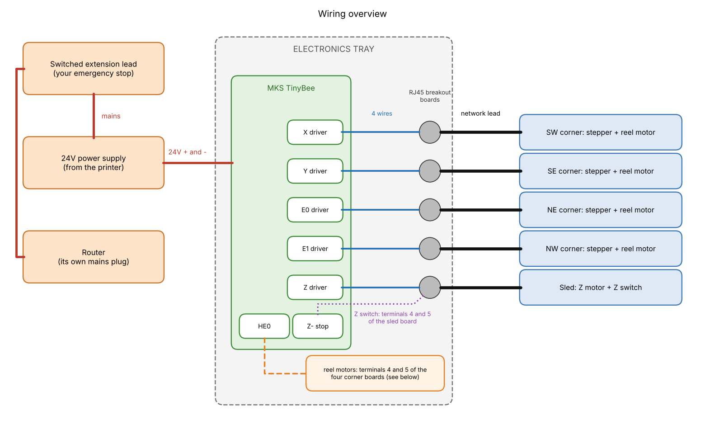
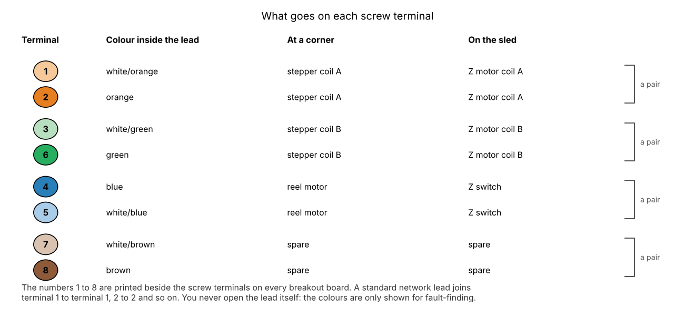

# Wiring guide for beginners

This covers everything electrical. No experience assumed, and almost no soldering: the leads are ordinary network cables, and every wire goes under a screw terminal.

**The whole job in one paragraph.** One board in a tray drives five motors. Each corner of the table has a stepper motor and a small reel motor, joined to the tray by one network lead. The sled has the Z motor and a switch on a fifth lead. At each end of every lead is a small "RJ45 breakout board": a network socket with eight numbered screw terminals. The power supply from the old printer feeds the main board. The router has its own mains plug and is not wired to the board at all.

## Stay safe

- **Everything you wire is 24V or less.** It cannot shock you. Never open the power supply or work on anything mains.
- **Unplug from the wall before touching any wiring.** Not just switched off: unplugged.
- **Never plug or unplug a lead with the power on.** It can destroy the driver for that motor. This is the most common way people break these boards.
- **Never plug these leads into a computer, router or anything else.** They carry 24V motor current and would damage it. Label every lead and every socket "CNC ONLY".

## Tools

| Tool | Notes | Est. |
|---|---|---|
| Small flat screwdriver, 2 to 2.5mm | For the screw terminals | £3 |
| Wire strippers | The self-adjusting kind is easiest | £8 |
| Multimeter | Any cheap one with a continuity beep | £10 |
| Side cutters | | £5 |
| Lever connectors (Wago 221 style), 2-way | Five or six, for joining wires without solder | £4 |

A soldering iron is only needed if your reel motors or Z switch arrive without wires attached. Buy them pre-wired and you can skip it.

## How to put a wire in a screw terminal

1. Strip 6mm of insulation. Twist the strands tightly so none stray.
2. Undo the terminal screw until the opening is clear.
3. Push the bare end fully in, so no bare copper shows outside.
4. Tighten firmly, then tug the wire. It must not pull out.

**Tips**
- Thin wires hold better folded double before they go in.
- One stray strand touching the next terminal causes faults that are miserable to find. Look closely at each one.
- Do one board completely, test it, then do the next.

## What goes on which terminal

Write this on a card and keep it on the bench:

| Terminals | Corner boards | Sled board |
|---|---|---|
| 1 and 2 | Stepper, first pair | Z motor, first pair |
| 3 and 6 | Stepper, second pair | Z motor, second pair |
| 4 and 5 | Reel motor | Z switch |
| 7 and 8 | Not used | Not used |

Note the second pair is on 3 and **6**, not 3 and 4. That matches how the wires are twisted together inside a network lead.

## Finding the stepper's wire pairs

A stepper has four wires that make two pairs. You need to know which wires are partners. Colours are not reliable.

1. Set the multimeter to the continuity beep.
2. Touch one probe to any motor wire. Touch the other probe to each of the other three in turn. One of them beeps. Those two are a pair. The remaining two are the other pair.
3. Label them with tape.

No multimeter? Touch two bare wire ends together and spin the motor shaft with your fingers. If it suddenly feels stiff and notchy, those two are a pair.

It does not matter which pair goes on 1 and 2. If a motor turns the wrong way later, that is fixed in software.

## The leads

- **Corners:** any network lead that reaches. About 2m for the two near corners and 4m for the far ones, with half a metre to spare.
- **Sled:** about 3m, and it must be a flexible patch lead (the bendy kind with moulded plugs), because it moves all day. Stiff cable meant for wall runs will break.
- **Check each one is "straight".** Hold both plugs side by side, clips down. The colour order must be identical. A few old leads are "crossover" and swap two pairs: do not use those.
- Label both ends: SW, SE, NE, NW, SLED.

## Building it, in order

### 1. Corner units (four the same)

Each bracket has a panel hanging down with a grid of holes.

1. Fix a breakout board to the panel, socket pointing down or outward so the lead plugs in easily. Use two M3 screws through the board's own holes if they line up with the grid, or a sticky foam pad plus two zip ties through the grid.
2. Cut the stepper's lead so about 150mm stays on the motor. Keep the off-cut with its plug: you will use it in the tray.
3. Find the pairs. One pair into terminals 1 and 2, the other into 3 and 6.
4. Reel motor's two wires into terminals 4 and 5.
5. Zip-tie the loose wires to the bracket so nothing can tug on a terminal.

### 2. The sled

1. Fix a breakout board on top of the bridge, beside the Z motor, using the grid of small holes there (M3 x 12 screws with washers clamping the board's edges, or a foam pad).
2. Z motor: one pair into terminals 1 and 2, the other into 3 and 6.
3. Z switch: its two wires into terminals 4 and 5. Use the two outer tags of the switch.
4. Hang the lead from above so its weight is not on the socket.

### 3. The tray

1. Fix the main board on M3 standoffs: mark its holes on the tray floor and drill 2.8mm pilot holes.
2. Stick five breakout boards along the notched wall, one behind each notch, sockets facing the notches. Label them X (SW), Y (SE), E0 (NE), E1 (NW), Z (SLED).
3. Take the off-cut leads you saved from the motors. Each has a plug that fits a motor output on the main board. Plug one into the output of each name, find its pairs with the multimeter from the bare ends, and put them into terminals 1 and 2, and 3 and 6, of the matching breakout board.

   If the plugs do not fit your board's motor pins, use the connector kit to crimp new ones.
4. Sled board terminals 4 and 5 go to the main board's **Z-** endstop connector: one wire to the pin marked S (signal), one to the pin marked G or GND. Leave the third pin empty.

### 4. Reel motors

All of this is inside the tray.

1. The HE0 output is a pair of screw terminals on the main board, marked + and -.
2. From HE0 +, a wire to one leg of a resistor (join them with a lever connector). From the resistor's other leg, a wire to terminal 4 of the SW board.
3. Terminal 5 of the SW board to terminal 4 of the SE board.
4. Terminal 5 of the SE board back to HE0 -.
5. Do the same again with the second resistor for NE and NW, into the same HE0 terminals.

The resistors get warm. Stand them clear of plastic and other wires, not taped down.

### 5. Power

1. The power supply has screw terminals marked V+ and V- (or +24V and COM). Run two thick wires (at least 1mm², the printer's own are ideal) to the main board's power input: V+ to +, V- to -.
2. **Check this twice.** Reversed power kills the board instantly.
3. Leave the supply's mains side exactly as it came from the printer, with its original cable and cover.

### 6. Drivers

1. With the power off, press the five driver modules into their sockets. Each has pins labelled along its edges, and so does the board: match EN to EN and GND to GND. A driver fitted backwards is destroyed when you switch on.
2. Set the microstep jumpers under each driver for 16 microsteps, following the table in the TinyBee manual for your driver type.
3. Motor current is set by the tiny screw on each driver. Measure DC volts between the top of that screw and any GND pin, with the board powered and the leads unplugged. Aim for about 1.2V, which is roughly 0.85A on common TMC2209 modules. Check your driver's leaflet, because the formula differs between makers.

## Test before first power-on

Ten minutes here saves a board. Multimeter on the continuity beep, everything unplugged from the wall.

1. **Each lead, plugged into a breakout board at both ends:** terminal 1 on one board to terminal 1 on the other should beep. Repeat for 2, 3, 4, 5 and 6. Then terminal 1 against 2, 2 against 3 and so on, on one board with nothing wired to it: none should beep.
2. **Each corner unit:** terminals 1 and 2 beep together, 3 and 6 beep together, 2 and 3 do not.
3. **Power input:** board + to supply V+ beeps. Board + to board - does **not** beep.
4. **Look over every terminal** for stray strands.

Then plug in the leads, plug the supply into the wall, and switch on. The board's lights should come on and nothing should get warm in the first minute. If anything smells hot, switch off at once.

## If something is wrong

| Symptom | Likely cause |
|---|---|
| Motor buzzes or judders but does not turn | A pair is split: recheck which wires are partners, and that the second pair is on 3 and 6 |
| Motor does nothing | A loose terminal, a faulty lead, or the driver is not seated |
| Motor turns the wrong way | Normal. Fix in the config file (see firmware/INSTALL.md) |
| Motor gets too hot to touch | Driver current set too high |
| A reel turns the wrong way | Swap the wires on terminals 4 and 5 at that corner |
| Neither reel in a chain turns | A break somewhere in that chain: both must be plugged in for either to run |
| Z switch has no effect | With the sled lead plugged in, terminals 4 and 5 on the tray's sled board should beep when the lever is pressed (or stop beeping, depending on which tags you used) |
| A motor only misbehaves with one particular lead | That lead is crossover or damaged: swap it |

## Things I could not confirm

- I worked from the main board's published pin list, not from one in hand. Before wiring, look at your own TinyBee and its manual for: which way round the motor output pins are, the labels on the endstop connector, and the polarity marks on HE0 and the power input. The labels printed on the board are the authority.
- Breakout boards differ in size and hole positions between sellers, which is why the mounting panels have a grid of holes instead of a fixed pattern.
- Network cable is thinner than I'd normally choose for a stepper. By my calculation a 4m lead loses under a volt and barely warms at 1A, but check the leads by hand after the first long job. If one is warm, lower that driver's current.
