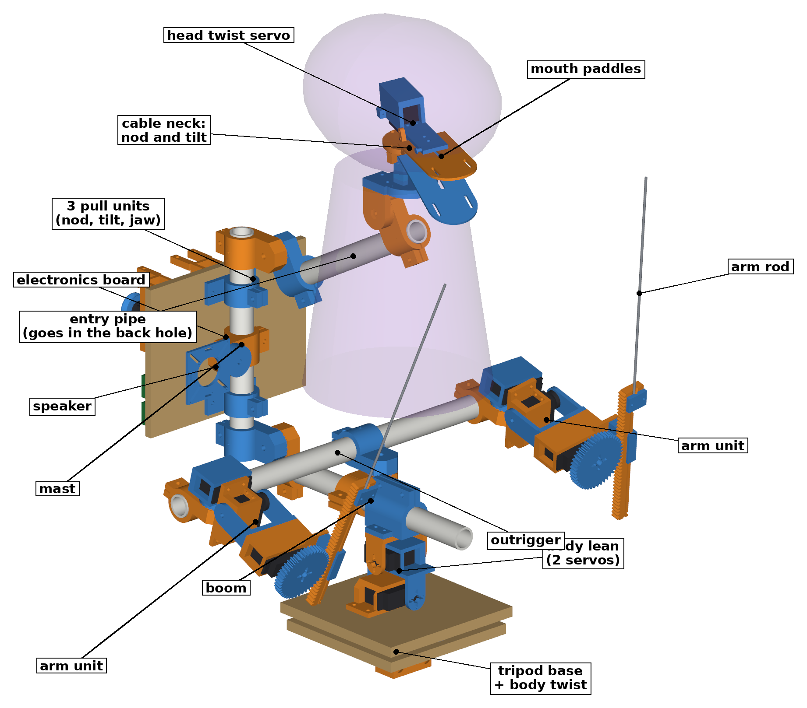
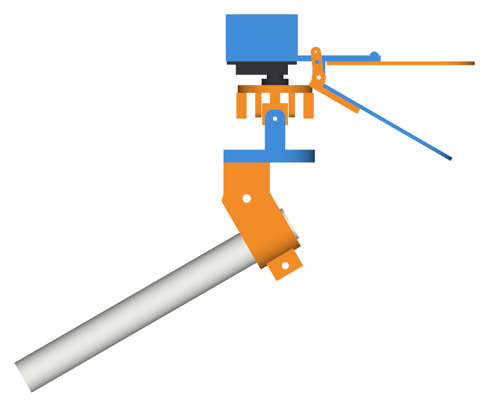

# Twist animatronic core

A removable, tripod-mounted mechanism that does what a puppeteer's hands do: twists and leans the body, turns, tilts and nods the head, works the mouth in time with speech, and aims and extends both arm rods. It goes in through the hole in the puppet's back and comes out again without modifying him.

The purple shape is a stand-in for the puppet.

## What it does

| Motion | Joint | Range | Driven by |
|---|---|---|---|
| Whole body twist | `yaw` | ±80° | MG996R on a lazy susan bearing |
| Body lean side to side | `lean_roll` | ±22° | DS3218 |
| Body lean forward / back | `lean_pitch` | ±22° | DS3218 |
| Head twist | `head_yaw` | ±80° | MG996R in the head |
| Head tilt left / right | `head_roll` | ±25° | Two lines from an MG996R on the mast |
| Head nod | `head_pitch` | ±28° | Two lines from an MG996R on the mast |
| Mouth | `jaw` | 40° open | One line closes, an elastic opens |
| Each arm rod: aim | `pan`, `tilt` | ±80°, ±48° | 2 x MG996R |
| Each arm rod: extend | `ext` | 90 mm stroke | MG996R on a rack and pinion |

Same thirteen motions as the first version, with 19 spare channels for eyebrows or eyelids later.

Speech comes from a speaker on the mast. The jaw follows the loudness of whatever is playing, whether that is a recorded WAV or typed text.

## What changed from version 1

Version 1 stacked four strong servos inside the puppet's head and neck. This version moves three of them out and pulls the head with lines running through thin PTFE tubes, the way a bicycle brake works.

| | Version 1 | Version 2 |
|---|---|---|
| Cost, everything new | about $400 to $420 | about $330 |
| Cost, AliExpress prices and a scrap PC power supply | | about $225 |
| Servos | 2 x 35 kg, 9 x 20 kg, 2 x 270° | 2 x 20 kg, 11 x MG996R |
| Inside the puppet | 66 mm wide, 150 mm tall, four servos | 65 mm at the neck, 41 mm at the head, 115 mm tall, one servo |
| Head motion | Direct drive, crisp | Lines, slightly softer, needs tensioning once |
| Head nod | 20° down, 28° up | 28° both ways |
| Arm piston stroke | 100 mm | 90 mm |
| Printing | 1.0 kg | 1.05 kg |

Printing did not shrink: the three pull units cost about what the old neck brackets saved. The gains are money and a much smaller, lighter head.

Version 1 is still in the git history at commit `ba3692b`.

## How it adjusts to other puppets

- The frame is plain pipe held in printed clamps. Slide any clamp along its pipe, or cut a longer pipe, to change height and reach.
- Every joint between pipes is a toothed knuckle that locks in 15° steps with one wing nut.
- Mouth paddles slide 45 mm in their slots and are a flat shape you can recut wider or narrower.
- Arm rod clamps take 2 to 8 mm rods. Arm units go anywhere along the outrigger and aim in any direction.
- Mouth open and closed angles, and all travel limits, are numbers in one config file.

## What is printed and what is not

About 1 kg of PETG, 50 pieces, 26 different parts.

Bought instead of printed, because it is cheaper, stiffer and faster:

- **PVC pipe** (or aluminium tube / dowel) for the boom, mast, entry pipe and outrigger.
- **Plywood** for the two turntable decks and the electronics board.
- **A lazy susan bearing** to carry the weight at the base.
- **PTFE tube and braided fishing line** for the head and jaw lines.
- **A rubber band** to open the mouth.
- Optionally **3 mm ply or acrylic** for the mouth paddles.

## The documents

1. [Shopping list](docs/SHOPPING.md) with links and a cost breakdown.
2. [Printing](docs/PRINTING.md): settings, quantities, and which four parts to test first.
3. [Assembly](docs/BUILD.md): nine stages with labelled pictures.
4. [Wiring](docs/WIRING.md).

Files: `print/stl/` printable parts, `print/twist_core_assembly.step.zip` whole rig, `cad/` parametric source, `software/` Raspberry Pi control panel.

## Camera and microphone later

The brain is a Raspberry Pi so these are plug-in additions: a Pi camera on the CSI port, a USB or I2S mic, and a printed `accessory_mount` that clips to any knuckle. See the last section of the shopping list and wiring guide.

## What has and hasn't been tested

Done in software:

- Every part builds as a single valid solid and is exported in its print orientation.
- The whole rig was assembled virtually and swept through 18 poses at the limits of travel, with every pair of parts checked for overlap. The limits in `config.json` come from that.
- The toothed joints were checked to mesh at 15° steps.
- The control software passes an off-hardware test (`software/test_software.py`): limits, pulse mapping, easing, the nod and tilt blending when the head is turned, lip-sync timing, web API.

Not done: nobody has printed and built this yet. Expect some fitting on a first build, in particular:

- **I designed this without Twist's measurements.** The default pipe lengths suit a puppet around 450 mm tall with a hand-sized back hole.
- **Line friction and stretch can't be simulated.** The geometry gives each line pair equal and opposite travel to within half a millimetre, and the servos have several times the pull needed, but how it feels depends on how gently the tubes are routed.
- **The jaw rests open when the power is off**, because the elastic opens it and the servo holds it shut. If you would rather it rest shut, swap them: hook the elastic to pull the lever back and run the line forward.
- **Servo dimensions vary by brand** by a millimetre or so. Hence the test prints.
- **PVC pipe flexes.** Fine for gentle character movement. For snappy moves or a heavy puppet use 25 mm aluminium tube.
- **The lean servos work hardest.** Keep the rig balanced over the tripod (slide the boom) and they will run cool.
- **Scrap stepper motors** are not catered for yet. The pull unit takes a hobby servo. Tell me the size, shaft and wire count of the motors you find and I'll add a stepper version that screws to the same board.
