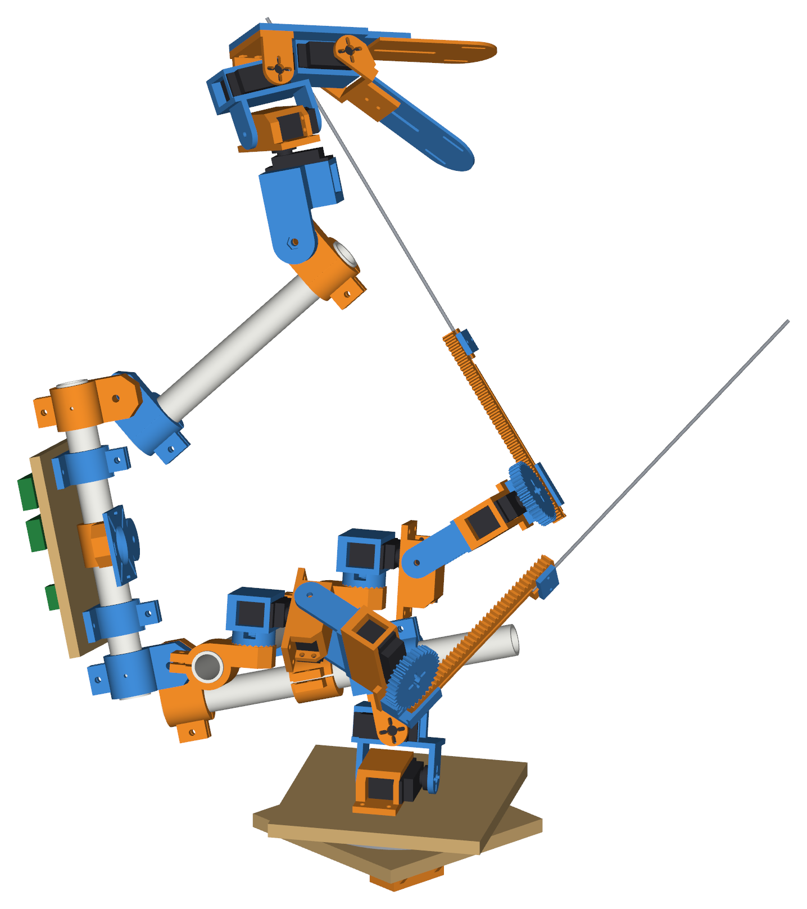

# Twist animatronic core

A removable, tripod-mounted mechanism that does what a puppeteer's hands do: twists and leans the body, turns, tilts and nods the head, works the mouth in time with speech, and aims and extends both arm rods. It goes in through the hole in the puppet's back and comes out again without modifying him.

The purple shape is a stand-in for the puppet.

## What it does

| Motion | Joint | Range | Servo |
|---|---|---|---|
| Whole body twist | `yaw` | ±80° | DS3218 on a lazy susan bearing |
| Body lean side to side | `lean_roll` | ±22° | DS3235 |
| Body lean forward / back | `lean_pitch` | ±22° | DS3235 |
| Head twist | `head_yaw` | ±80° | DS3218 |
| Head tilt left / right | `head_roll` | ±25° | DS3218 |
| Head nod | `head_pitch` | 20° down, 28° up | DS3218 |
| Mouth | `jaw` | 40° open | DS3218 |
| Each arm rod: aim | `pan`, `tilt` | ±80°, ±48° | 2 x DS3218 |
| Each arm rod: extend | `ext` | 100 mm stroke | DS3218 270° on a rack and pinion |

13 servos, with 19 spare channels for eyebrows or eyelids later.

Speech comes from a speaker on the mast. The jaw follows the loudness of whatever is playing, whether that is a recorded WAV or typed text.

## How it adjusts to other puppets

- The frame is plain pipe held in printed clamps. Slide any clamp along its pipe, or cut a longer pipe, to change height and reach.
- Every joint between pipes is a toothed knuckle that locks in 15° steps with one wing nut.
- Mouth paddles slide 45 mm in their slots and are a flat shape you can recut wider or narrower.
- Arm rod clamps take 2 to 8 mm rods. Arm units go anywhere along the outrigger and aim in any direction.
- Mouth open and closed angles, and all travel limits, are numbers in one config file.

## What is printed and what is not

About 1 kg of PETG across 21 different parts. Three shapes repeat through the whole build (a servo bracket and two yokes), so there is not much to learn.

Bought instead of printed, because it is cheaper, stiffer and faster:

- **PVC pipe** (or aluminium tube / dowel) for the boom, mast, entry pipe and outrigger.
- **Plywood** for the two turntable decks and the electronics board.
- **A lazy susan bearing** to carry the weight at the base.
- Optionally **3 mm ply or acrylic** for the mouth paddles.

## The documents

1. [Shopping list](docs/SHOPPING.md) with links. About $400 all in.
2. [Printing](docs/PRINTING.md): settings, quantities, and which three parts to test first.
3. [Assembly](docs/BUILD.md): eight stages with labelled pictures.
4. [Wiring](docs/WIRING.md).

Files: `print/stl/` printable parts, `print/twist_core_assembly.step.zip` whole rig, `cad/` parametric source, `software/` Raspberry Pi control panel.

## Camera and microphone later

The brain is a Raspberry Pi so these are plug-in additions: a Pi camera on the CSI port, a USB or I2S mic, and a printed `accessory_mount` that clips to any knuckle. See the last section of the shopping list and wiring guide.

## What has and hasn't been tested

Done in software:

- Every part builds as a single valid solid and is exported in its print orientation.
- The whole rig was assembled virtually and swept through 17 poses at the limits of travel, with every pair of parts checked for overlap, in both pipe sizes. The limits in `config.json` come from that.
- The toothed joints were checked to mesh at 15° steps.
- The control software passes an off-hardware test (`software/test_software.py`): limits, pulse mapping, easing, lip-sync timing, web API.

Not done: nobody has printed and built this yet. Expect some fitting on a first build, in particular:

- **I designed this without Twist's measurements.** The default pipe lengths suit a puppet around 450 mm tall with a hand-sized back hole. Check the head module (66 mm wide, 150 mm tall) against his neck before printing everything.
- **Servo dimensions vary by brand** by a millimetre or so. Hence the three test prints.
- **PVC pipe flexes.** Fine for gentle character movement. For snappy moves or a heavy puppet use 25 mm aluminium tube.
- **The lean servos work hardest.** Keep the rig balanced over the tripod (slide the boom) and they will run cool.
- Use a sturdy tripod. The rig weighs about 3 kg and moves its weight around.
