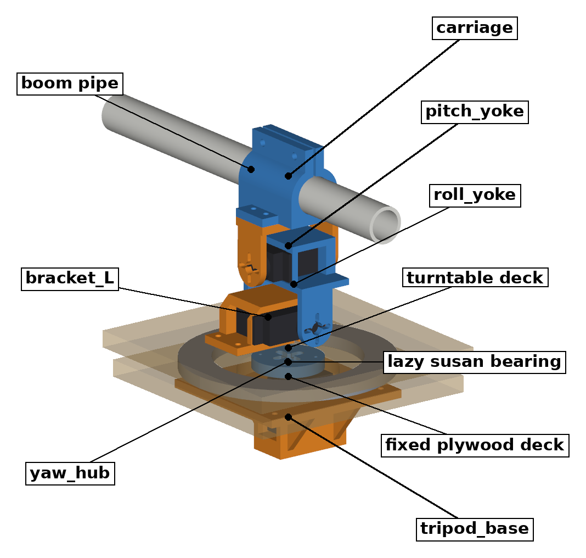
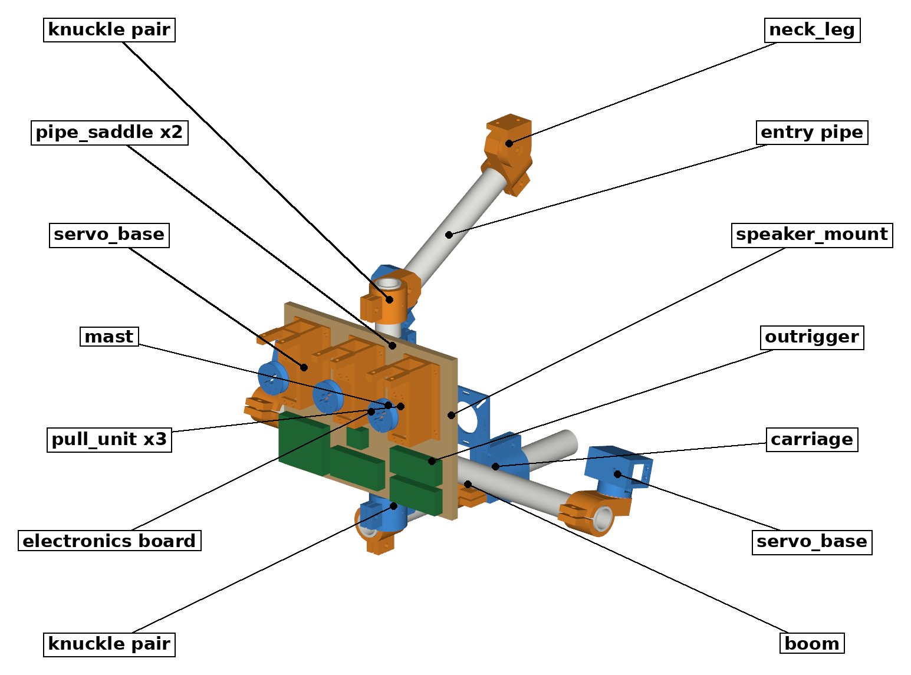
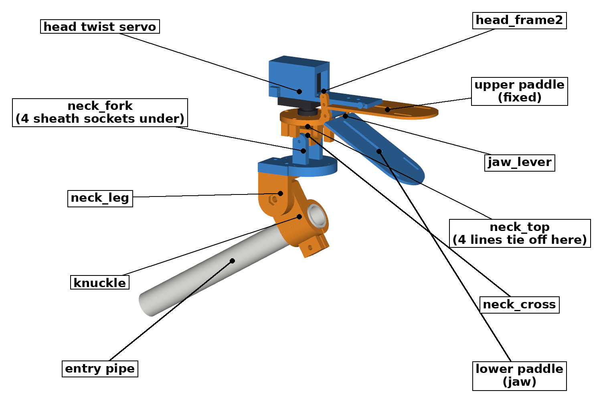
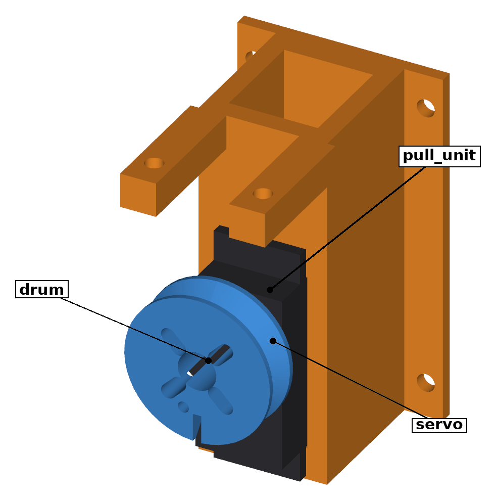
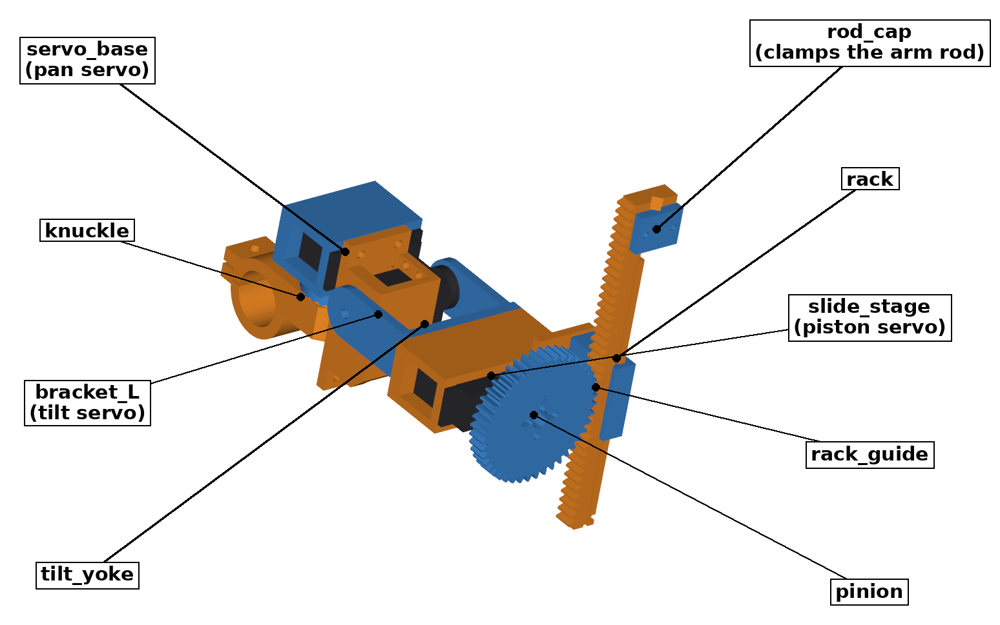

# Assembly

Allow a weekend once the parts are printed. Tools: 2, 2.5, 3, 4 mm hex keys, 7 / 8 / 10 mm spanners, a drill with 3 mm and 4.5 mm bits, a 68 to 76 mm hole saw (or a jigsaw), a hacksaw, a soldering iron, a multimeter.

Three habits that save grief:

- **Centre every servo before fitting its horn.** Do the electronics (stage 6) on the bench first, run `python3 center.py`, and leave it running while you fit horns. Each joint is then built in its middle position.
- **Remove the rubber grommets from the servo ears.** The M4 screws go straight through the ears for a rigid mount.
- **Don't overtighten pivots.** The M5 pivot bolts are hinges. Snug, then back off a quarter turn. The nyloc nut keeps them there.

## How a joint goes together

Every moving joint is the same idea, so learn it once.

A servo sits in a printed **cage** and is held by four M4 x 16 screws with nyloc nuts through its ears. A **yoke** straddles the cage. One arm of the yoke bolts to the servo's disc horn with four M3 x 8 screws through the slots. The other arm pivots on an M5 x 16 bolt that screws into an M5 nyloc nut trapped in the back of the cage.

Order matters:

1. Press the M5 nyloc nut into the hex pocket inside the back of the cage (nylon end first, facing the servo).
2. Drop the servo in and fit its four M4 screws.
3. Push the disc horn onto the spline (servo centred) and fit the horn's centre screw.
4. Spring the yoke over. On the pivot side put one M5 washer between yoke and cage and two under the bolt head, then fit the M5 x 16.
5. Fit the four M3 screws through the yoke's slots into the horn.

## Stage 1: Base and body twist



1. Cut two plywood decks: 170 x 170 mm (fixed) and 180 x 180 mm (turntable). Cut a 68 to 76 mm hole through the centre of the fixed deck.
2. Press the 1/4"-20 nut into the hex pocket in the floor of `tripod_base`. Drop the twist servo in on top of it (shaft toward the middle of the square flange) and fit its four M4 screws. Use button heads here: they must sit below the flange face.
3. Screw `tripod_base` to the underside of the fixed deck with four 4 x 16 wood screws, servo poking up through the hole.
4. Sit the lazy susan on the fixed deck, centred on the servo shaft, and fix it with 3.5 x 10 screws.
5. Fit a disc horn to the servo, then bolt `yaw_hub` to the horn with four M3 x 8 (heads sit in the counterbores).
6. Lay the turntable deck on the lazy susan. Screw the bearing's top ring to it from below through the access holes most bearings have, or from above if yours lacks them. Then drive four 3.5 x 20 screws down through the deck into the pilot holes of `yaw_hub`.
7. The hub's thickness assumes 12 mm ply and an 8.5 mm bearing. If yours differ, change `PLY` and `LAZY_SUSAN_T` in `cad/parts.py` and reprint the hub, or shim with washers.

## Stage 2: Body lean

1. Screw a `bracket_L` to the middle of the turntable deck with four 4 x 16 wood screws, so the centre of its slotted horn pattern sits over the twist axis. Fit a DS3218 in it, shaft pointing forward.
2. Build the joint with a `roll_yoke` over it. Fit the second DS3218 in the cage on top of the roll yoke.
3. Press four M4 plain nuts into the pockets under the top plate of a `pitch_yoke`, then build that joint over the second servo.
4. Bolt the `carriage` on top with four M4 x 12.

## Stage 3: Frame



Cut the pipe: boom 320 mm, mast 300 mm, entry pipe 240 mm, outrigger 470 mm. These suit a puppet about 450 mm tall. Longer is fine, you can always slide a clamp along.

1. Slide the boom through the carriage and nip up its two M5 x 25 pinch bolts.
2. A **knuckle pair** is two knuckles face to face with an M6 x 50 bolt and wing nut through the middle. The teeth lock every 15°. Loosen the wing nut two turns to change the angle.
3. Knuckle pair at the back of the boom, mast standing up from it.
4. Knuckle pair at the top of the mast, entry pipe heading forward and up at about 30°.
5. One knuckle on the front end of the entry pipe. Bolt `neck_leg` to it with the M6 x 35 (nut in the hex pocket on the outside of the leg). The leg hangs to one side of the knuckle so the neck ends up on the centre line.
6. Knuckle pair just behind the carriage, carrying the outrigger across the boom.
7. Screw the two `pipe_saddle` clamps to the front of the electronics board with 3.5 x 12 screws and clamp them to the mast.
8. Knuckle on the mast for `speaker_mount` (M6 x 30 into its captive nut).

Leave everything finger tight for now.

## Stage 4: Neck, head and jaw



The head no longer carries a stack of servos. A small two-way joint lets it nod and tilt, four lines pull it, and one servo above the joint twists it. All the pulling is done by servos on the electronics board.

1. Press two M4 nuts into the pockets under the tab of `neck_leg`. Sit `neck_fork` on the tab and fix it with two M4 x 16 from above.
2. Drop `neck_cross` into the fork, low hole side to side. Push the M3 x 40 through fork and cross, add a nyloc nut, snug it and back off a quarter turn. This is the nod pin.
3. Head-twist servo into the cage of `head_frame2`, pushed in from below with its shaft pointing down. Four M4 x 16. Fit a disc horn (servo centred).
4. Bolt `neck_top` to that horn from underneath with four M3 x 6, posts pointing down.
5. Lower `neck_top` over the cross so its two tabs straddle it front and back. Push the M3 x 35 through front to back. This is the tilt pin.
6. Hold `jaw_lever` under the front of `head_frame2`, cheeks outside the hinge block, lever on the same side as the small sheath block. M3 x 45 through as the hinge, nyloc nut, leave it free.
7. Bolt one paddle under the front of `head_frame2` and one on top of the jaw's tongue, two M4 x 16 each through the long slot.

The head should now flop freely in every direction and the jaw should swing. If anything binds, loosen that pin a touch.

Size inside the puppet: 65 mm across at the neck joint, 41 mm across at the head (the paddles are 56), about 115 mm from the bottom of the fork to the top of the twist servo.

## Stage 4b: Pull units and lines



Do this after stage 6 so you can power the servos.

**Pull units.** Screw the three `pull_unit` parts across the top of the back of the electronics board, sheath sockets pointing up, with four 3.5 x 12 screws each. Drop a servo in each (four M4 x 16). With the servos held at centre by `center.py`, fit a horn and bolt a `drum` to it with four M3 x 12, the slot in the drum's rim pointing away from the sockets.

**Sheaths.** Cut five lengths of PTFE tube with a sharp blade, square ends. Run each from a pull-unit socket, up the mast, along the entry pipe, to its socket:

| Line | From | To |
|---|---|---|
| Nod, front | Nod unit, either socket | Front socket under `neck_fork` |
| Nod, back | Nod unit, other socket | Back socket |
| Tilt, left | Tilt unit | Left socket |
| Tilt, right | Tilt unit | Right socket |
| Jaw | Jaw unit, either socket | Block on the side of `head_frame2` |

Leave gentle curves and no kinks. The jaw sheath needs a loose loop where it passes the neck, because the head turns 80° each way above it. Tie the sheaths to the pipes with cable ties, snug but not crushing.

**Neck lines.** For each of the four:

1. Tie a fat knot (a figure-eight, doubled) in the end of the fishing line and add a drop of superglue.
2. Thread the other end down through the hole in the top of `neck_top`, so the knot seats in its recess, down the post, straight down into the hole in `neck_fork` below it, and on through the sheath to the pull unit.
3. At the drum, lay the line in the groove, round the back, up through the slot in the rim.

With the head held level and the servo at centre, pull both lines of a pair snug and trap them together under an M3 x 8 and washer in the drum's small hole. Snug means no slack, not guitar-string tight.

**Jaw line.** Knot the line through the small hole in the tip of the jaw lever, run it back through the sheath block and sheath to the jaw unit, and clamp it on the drum with the mouth held shut and the servo at centre. Loop a rubber band from the lever's larger hole forward to the peg on the side of `head_frame2`. The band opens the mouth, the line closes it.

**To puppeteer an axis by hand** some day, undo the drum screw and tie that line to a lever or a loop for your finger.

## Stage 5: Arm units (build two)



1. Pan servo into `servo_base`. Horn on.
2. `bracket_L` onto that horn (M3 x 6 from inside), tilt servo into it.
3. `tilt_yoke` (four nuts in first) over the tilt servo.
4. Bolt `slide_stage` on top with four M4 x 10 socket heads. Two go in through the floor of the cage, two through the access holes in the shelf.
5. Piston servo into the stage, shaft up. Horn on, then `pinion` on the horn with four M3 x 12.
6. Slide two M4 nuts into the slots at the back of `rack_guide` and bolt it to the shelf from below with two M4 x 16.
7. Slide the `rack` into the guide from the front, teeth meshing with the pinion at about the middle of the rack. Fit an M3 x 16 and nut through the hole in the tail end as an end stop. A dab of silicone grease in the guide helps.
8. Clamp a knuckle on each end of the outrigger and bolt the `servo_base` to it with an M6 x 30.
9. Twist's arm rod lies in the V on the rack's front pad. `rod_cap` and two M3 x 16 clamp it. Rods from 2 to 8 mm fit.

At rest the rod points straight out along the rack. Rotate the knuckle on the outrigger to choose where "rest" aims: about 75° above horizontal, toward the puppet's wrist, is a good start.

## Stage 6: Electronics and software

Wire it up per [WIRING.md](WIRING.md). Then on the Pi (Raspberry Pi OS Lite, with SSH and Wi-Fi set in Raspberry Pi Imager):

```bash
sudo raspi-config nonint do_i2c 0
echo "dtoverlay=max98357a" | sudo tee -a /boot/firmware/config.txt
sudo apt update && sudo apt install -y python3-venv python3-numpy espeak-ng alsa-utils git i2c-tools
# copy the twist-animatronic folder to /home/pi, then:
python3 -m venv --system-site-packages ~/twist-venv
~/twist-venv/bin/pip install -r ~/twist-animatronic/software/requirements.txt
sudo reboot
```

After the reboot `i2cdetect -y 1` should show `40` and `41`, and `speaker-test -t sine -f 440 -l 1` should beep.

```bash
cd ~/twist-animatronic/software
~/twist-venv/bin/python center.py        # holds all servos at centre while you fit horns
~/twist-venv/bin/python run.py           # control panel on http://<pi address>:8080
```

To start on boot: `sudo cp twist.service /etc/systemd/system/ && sudo systemctl enable --now twist`.

You can try the panel on any computer first with `python3 run.py --mock`.

## Stage 7: Calibrate

Open the panel, expand **Calibration**.

1. With every slider at 0, each joint should sit square. If one is a little off, nudge its "centre us" value (10 us is about 1°) until it is. Bigger errors: lift the horn off and move it one spline tooth, or for the cable joints re-clamp the lines.
2. Move each slider. If a joint goes the wrong way, tick **invert**. For nod and tilt you can also just swap the two sheaths at the pull unit.
3. Check the head with the twist at 0 first: `head_pitch` should nod, `head_roll` should tilt. Then turn the head and nod again. The software blends the nod and tilt lines so the head still nods toward wherever it is facing. If it nods sideways when turned, one of the three head joints needs **invert**.
4. Cable joints have a `gear` number in `config.json`: how far the servo turns per degree at the joint. If the head only reaches 20° when you ask for 28°, raise `gear` for that joint in proportion.
5. Set the jaw: `jaw_closed` is the angle where Twist's mouth is just shut and `jaw_open` is a natural wide-open. Find both with the jaw slider.
6. Press **Save calibration**.

Software limits in `config.json` are already inside the collision-checked range. Narrow them if the puppet's fabric binds earlier. Widen them only after checking by hand.

## Stage 8: Dress the puppet

1. Feed the head in through the hole in Twist's back, paddles first, and up into the mouth: upper paddle above the top mouth plate where fingers go, lower paddle under the bottom plate where the thumb goes.
2. Loop a velcro strap or elastic through the paddle's side slots and around each mouth plate.
3. Adjust until the jaw hinge lines up with the hinge of his mouth: slide the paddles in their slots, slide the entry pipe in its clamps, change the mast height, step the knuckle angles.
4. Slide the boom in the carriage until the rig balances over the tripod with all servos relaxed.
5. Clamp the arm rods.
6. When it all sits right, tighten everything and drive a 3.5 x 13 self-tapper through the small hole in each clamp into the pipe.

To take Twist off: undo the two straps and the rod clamps, and lift him forward off the paddles. To fit another puppet, repeat this stage. Nothing needs reprinting unless the new puppet's mouth wants wider or narrower paddles.

## Using it

- **Sliders** move each joint. Moves are eased and speed limited so nothing snaps.
- **Say** speaks typed text and moves the jaw with it. **Sound buttons** play any WAV you drop in `software/sounds/` with the same lip sync. Record Twist's lines in his own voice, export as WAV, done.
- **Poses** recall saved positions. Set the sliders, type a name, save.
- **Idle** gives him breathing and small glances so he never looks switched off.
- **Gamepad**: plug a controller into the phone or laptop showing the panel. Left stick head, right stick body, right trigger jaw, d-pad arms.
- **Relax** cuts servo drive so you can pose him by hand or carry the rig.

Lip sync works by measuring loudness in 20 ms slices ahead of playback and sending the jaw there 80 ms early to cover servo travel. If the mouth feels late or early, change `lead_ms` in `config.json`.
