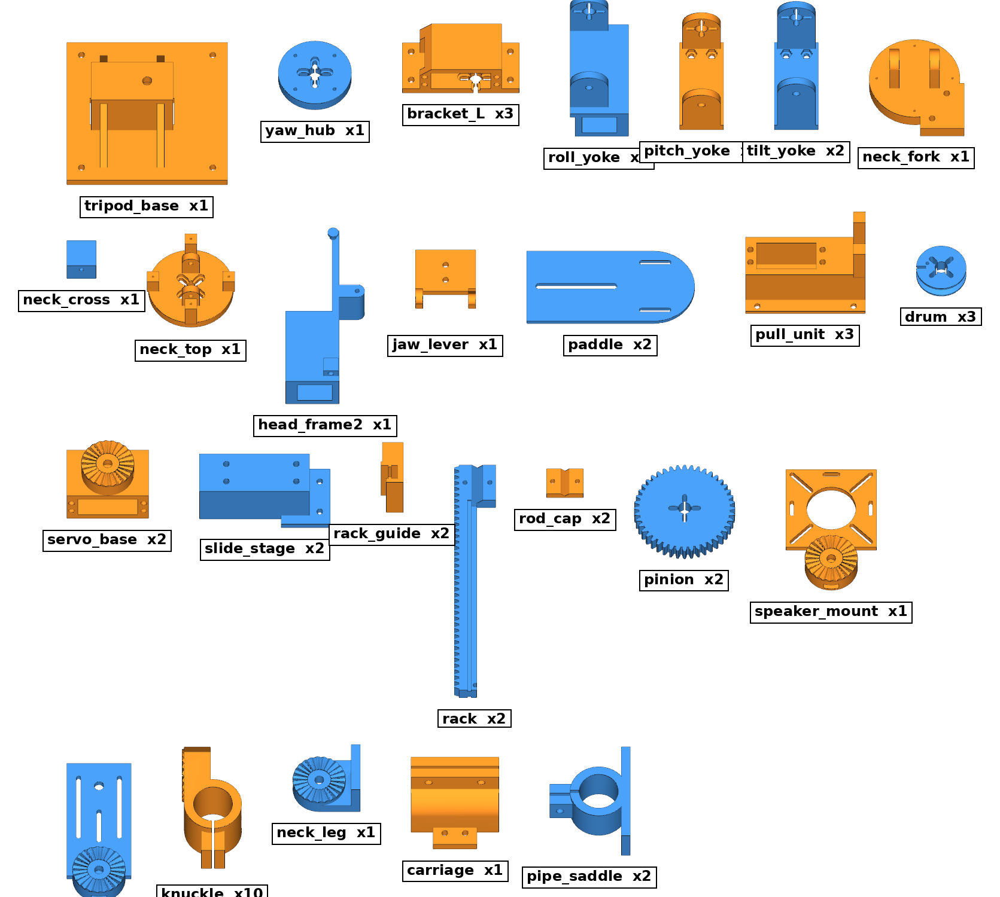

# Printing

Every STL in `print/stl/` is already turned the right way up for printing. Drop it on the bed and slice.

## Settings

| Setting | Value |
|---|---|
| Material | PETG. PLA works on the bench but creeps under clamp load and softens in a hot car or under stage lights |
| Nozzle / layer | 0.4 mm / 0.2 mm |
| Walls | 4 (5 where the notes say so) |
| Infill | 30% gyroid (40% where noted) |
| Top / bottom | 5 layers |
| Bed needed | 180 x 180 mm. The rack goes on diagonally |

50 parts, about 1.0 kg of filament, roughly 65 to 85 hours of printing. Buy two 1 kg spools so a failed print doesn't stop you.

## Print these four first

Servo and pipe dimensions vary a little between brands. Before committing a kilo of plastic:

1. **One `bracket_L`.** Drop a servo in. It should slide in with a hair of clearance and the ear holes should line up. Bolt a disc horn to the slotted pattern.
2. **One `knuckle`.** Push it onto your pipe and nip up the M5 bolt. It should grip hard before the slot closes.
3. **One `tilt_yoke`.** Fit it over the bracket and servo: horn side onto the horn, M5 pivot on the other side. It should swing freely with no side slop.
4. **`neck_fork`.** Push a piece of your PTFE tube into a socket underneath. It should press in by hand and stay. Thread the line through the small hole.

If something is off, change the numbers at the top of `cad/parts.py` (`SL`, `SW`, `EAR_Z`, `HORN_Z` for the servo, `SHEATH_R` and `LINE_R` for the cable, the pipe size in `cad/build.py`) and run `python3 cad/build.py`. Everything regenerates to match. `HORN_Z` is the one most likely to need a tweak: it is the distance from the bottom of the servo to the top face of the horn, 46.0 mm by default.

## Parts common to every build

| Part | Qty | Size on bed (mm) | Supports | Notes |
|---|---|---|---|---|
| `tripod_base` | 1 | 110 x 110 x 46 | no | Flange on the bed. 5 walls, 40% infill: this carries everything. |
| `yaw_hub` | 1 | 50 x 50 x 8 | no |  |
| `bracket_L` | 3 | 80 x 36 x 31 | no | Plate on the bed. Top wall is a 36 mm bridge. |
| `roll_yoke` | 1 | 40 x 71 x 69 | yes, bed only | Servo cage on the bed, arms pointing up. |
| `pitch_yoke` | 1 | 30 x 66 x 46 | no | Top plate on the bed, arms pointing up. |
| `tilt_yoke` | 2 | 30 x 66 x 61 | no | Tall version of pitch_yoke for the arm units. |
| `neck_fork` | 1 | 65 x 71 x 42 | no | Disc on the bed, fork up. |
| `neck_cross` | 1 | 20 x 20 x 17 | no | 100% infill, it is tiny. |
| `neck_top` | 1 | 60 x 60 x 26 | no | Disc on the bed, posts up. |
| `head_frame2` | 1 | 54 x 120 x 37 | no | On its side. Top wall is a 24 mm bridge. |
| `jaw_lever` | 1 | 41 x 56 x 30 | no | Tongue on the bed, lever up. |
| `paddle` | 2 | 115 x 56 x 3 | no | Or cut from 3 mm plywood or acrylic. |
| `pull_unit` | 3 | 82 x 48 x 67 | no | Flange on the bed. |
| `drum` | 3 | 34 x 34 x 10 | no | 4 walls. |
| `servo_base` | 2 | 56 x 36 x 43 | no | Teeth facing up. |
| `slide_stage` | 2 | 89 x 44 x 36 | no | Shelf on the bed. |
| `rack_guide` | 2 | 15 x 32 x 40 | no | Standing on end. |
| `rack` | 2 | 28 x 180 x 10 | no | 180 mm long: place diagonally on small beds. |
| `rod_cap` | 2 | 25 x 20 x 5 | no |  |
| `pinion` | 2 | 69 x 69 x 10 | no | 4 walls. |
| `speaker_mount` | 1 | 62 x 94 x 13 | no | Teeth facing up. |
| `accessory_mount` | 1 | 44 x 108 x 13 | no | Optional. Camera, mic, light. |

## Parts that depend on your pipe

Pick **one** folder: `pipe_26.7mm` (3/4 inch or 20 mm PVC pressure pipe) or `pipe_25.0mm` (25 mm aluminium tube or dowel). For any other diameter, add it to `PIPES` in `cad/build.py`.

| Part | Qty | Size on bed (mm) | Supports | Notes |
|---|---|---|---|---|
| `knuckle` | 10 | 41 x 85 x 36 | no | Bore vertical. 5 walls. Print one first and test it on your pipe. |
| `neck_leg` | 1 | 46 x 36 x 29 | no | Teeth up. |
| `carriage` | 1 | 60 x 66 x 54 | no | Flange on the bed. 5 walls, 40% infill. |
| `pipe_saddle` | 2 | 55 x 71 x 26 | no | Bore vertical. |

The ten knuckles are: 6 for the frame (three adjustable joints), 2 for the arm units, 1 for the speaker, 1 for the neck. Print an eleventh if you use the accessory mount.

## Source and whole-rig model

- `cad/parts.py` holds every part as parametric CadQuery code.
- `cad/assembly.py` puts them together; `cad/check.py` sweeps the joints through their travel and reports any two parts that touch.
- `print/twist_core_assembly.step.zip` is the full rig for opening in Fusion, FreeCAD or Onshape.
