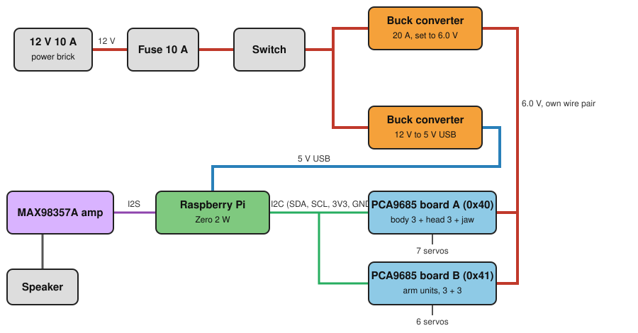

# Wiring

## Power

Servos are hungry and electrically noisy, so they get their own 6 V rail. The Pi gets a separate, clean 5 V.

1. 12 V brick → barrel jack adapter → fuse (10 A) → switch.
2. From the switch, 12 V goes two ways: to the big buck converter and to the small 5 V USB buck.
3. **Before connecting any servo**, power up and turn the big buck converter's trimmer until a multimeter reads 6.0 V on its output.
4. Run a separate pair of 16 AWG wires from the 6 V output to the green power terminal on each PCA9685 board. Do not daisy-chain servo power from one board to the other.
5. Solder a 1000 µF capacitor into the empty capacitor spot on each board (stripe to minus).
6. The 5 V USB buck plugs into the Pi.

Never feed servo power from the Pi's 5 V pin. Thirteen servos can pull 10 A in a burst and would brown the Pi out.

Using a scrap PC power supply instead: skip steps 1 to 3 and 6. Take 5 V (red wires) and ground (black) to both servo boards on separate pairs, and a third pair to the Pi's 5 V and GND pins with a 1000 µF capacitor across them at the Pi.

If a servo board gets warm, the two body-lean servos are the reason. Wire their red and black leads straight to the 6 V output and leave only the signal wire on the board.

## Signal

| From Pi (pin) | To |
|---|---|
| 3V3 (pin 1) | VCC on both PCA9685 boards |
| GPIO2 SDA (pin 3) | SDA on both boards |
| GPIO3 SCL (pin 5) | SCL on both boards |
| GND (pin 6) | GND on both boards |
| 5V (pin 4) | Vin on MAX98357A |
| GND (pin 14) | GND on MAX98357A |
| GPIO18 (pin 12) | BCLK on MAX98357A |
| GPIO19 (pin 35) | LRC on MAX98357A |
| GPIO21 (pin 40) | DIN on MAX98357A |

Board B needs a different address: bridge the **A0** solder pads on it so it becomes `0x41`. Board A stays at `0x40`. The boards have matching headers on both ends, so chain A into B with a 6-way jumper.

The speaker's two wires go to the screw terminal on the amplifier.

## Servo channels

Brown or black wire toward the edge of the board (GND), orange or yellow toward the middle (signal).

| Board | Channel | Joint | Servo | Where the servo sits |
|---|---|---|---|---|
| A | 0 | `yaw` body twist | MG996R | In `tripod_base` |
| A | 1 | `lean_roll` body lean left/right | DS3218 | Lean stack on the turntable |
| A | 2 | `lean_pitch` body lean forward/back | DS3218 | Lean stack |
| A | 4 | `head_yaw` head twist | MG996R | In the puppet's head (`head_frame2`) |
| A | 5 | `head_roll` head tilt | MG996R | Pull unit on the electronics board |
| A | 6 | `head_pitch` head nod | MG996R | Pull unit |
| A | 7 | `jaw` | MG996R | Pull unit |
| B | 0 | `pan_l` left arm aim sideways | MG996R | Arm unit |
| B | 1 | `tilt_l` left arm aim up/down | MG996R | Arm unit |
| B | 2 | `ext_l` left arm piston | MG996R | Arm unit |
| B | 4 | `pan_r` | MG996R | Arm unit |
| B | 5 | `tilt_r` | MG996R | Arm unit |
| B | 6 | `ext_r` | MG996R | Arm unit |

Spare: A3, A8 to A15, B3, B7 to B15.

## Where it all lives

Screw the Pi, both servo boards, the big buck converter and the amplifier to the lower half of the electronics board on standoffs, and the three pull units across the top half with their sheath sockets pointing up. The board clamps to the mast with two `pipe_saddle` parts, so everything rides with the puppet and only one cable (12 V) runs down to the floor. Leave that cable a loose loop at the turntable so Twist can turn 80° each way without tugging it.

The weight of the electronics at the back also balances the arm units at the front, which is kind to the lean servos.

## Later: camera and mic

- **Camera:** ribbon cable into the Pi's CSI port. No GPIO needed.
- **USB mic:** into the Pi's USB port (the Zero needs a micro-USB OTG adapter).
- **I2S mic** (Adafruit 3421): 3V, GND, BCLK to GPIO18, LRCL to GPIO19 (both shared with the amp), DOUT to GPIO20 (pin 38).
